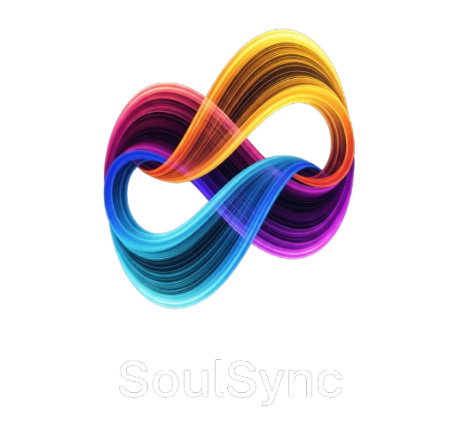
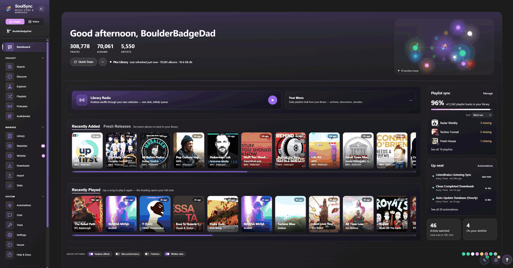
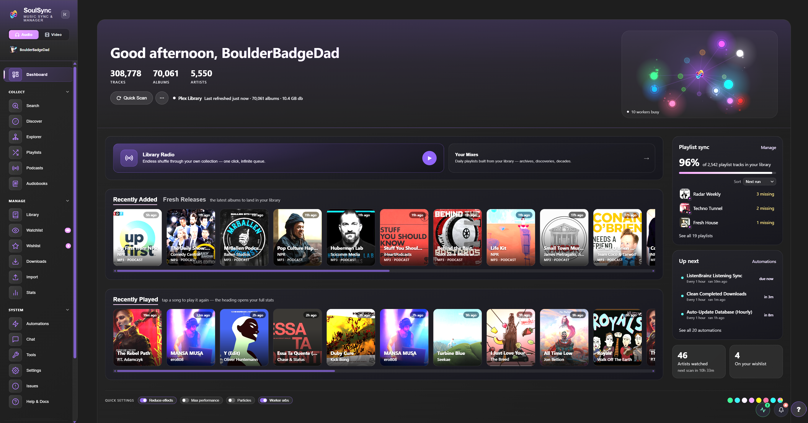

<a id="top"></a>

<p align="center">
  
</p>

<h3 align="center">The self-hosted home for your music, movies, TV and YouTube.</h3>

<p align="center">
  Find it, fetch it, verify it, tag it, file it, play it.<br>
  One app in place of a stack of *arr apps, taggers and scripts, and it actually knows your library.
</p>

<p align="center">
  <a href="https://github.com/Nezreka/SoulSync/releases"></a>
  <a href="https://github.com/Nezreka/SoulSync/actions/workflows/dev-nightly.yml"></a>
  <a href="https://hub.docker.com/r/boulderbadgedad/soulsync"></a>
  <a href="https://github.com/Nezreka/SoulSync/stargazers"></a>
  <a href="https://discord.gg/wGvKqVQwmy"></a>
  <a href="./license.txt"></a>
  <a href="https://ko-fi.com/boulderbadgedad"></a>
</p>

<p align="center">
  <a href="https://www.ssync.net/"><b>Website</b></a> &nbsp;·&nbsp;
  <a href="#quick-start"><b>Quick start</b></a> &nbsp;·&nbsp;
  <a href="#installation"><b>Install</b></a> &nbsp;·&nbsp;
  <a href="#setup-guide"><b>Setup guide</b></a> &nbsp;·&nbsp;
  <a href="https://discord.gg/wGvKqVQwmy"><b>Discord</b></a> &nbsp;·&nbsp;
  <a href="https://github.com/Nezreka/SoulSync/issues"><b>Issues</b></a>
</p>

<p align="center">
  
</p>

## Why SoulSync

Most self-hosted media setups are a relay race: one app wants things, another searches, a third downloads, a fourth tags, a fifth tells the server, and when a handoff fails nobody notices. SoulSync runs the whole race itself and keeps the receipts.

<table>
<tr>
<td width="50%" valign="top">

**It knows what you own**<br>
Every search, playlist and recommendation is checked against your real library, so "missing" means missing.

</td>
<td width="50%" valign="top">

**It checks its work**<br>
Downloads are fingerprinted, sanity checked, quality ranked and quarantined when they don't hold up. Nothing lands in your library on faith.

</td>
</tr>
<tr>
<td valign="top">

**It explains itself**<br>
Stuck wishlist rows show exactly which releases were refused and why. Every download has an audit trail.

</td>
<td valign="top">

**It's one app for the whole house**<br>
Music, movies, TV, YouTube, podcasts and audiobooks, with profiles so everyone gets their own taste, playlists and history.

</td>
</tr>
<tr>
<td colspan="2" valign="top">

**It's only as big as you want it**<br>
Use one part or all of it. **Customize** in the sidebar hides what you don't use, and each profile picks its own.

</td>
</tr>
</table>

## Quick start

```bash
curl -O https://raw.githubusercontent.com/Nezreka/SoulSync/main/docker-compose.yml
docker compose up -d
# open http://localhost:8008
```

First-run setup finds your media server and download clients on its own. You don't need any of them to start: SoulSync Standalone runs without a media server, and HiFi, YouTube and Deezer need no extra software. Unraid, plain Python and the release channels are under [Installation](#installation).

> [!IMPORTANT]
> If you use Soulseek, **share files in slskd** (`http://localhost:5030/shares`). Leechers get banned by the network.

## At a glance

| | |
|---|---|
| **Download sources** | Soulseek (slskd), Tidal, Qobuz, Deezer, HiFi, YouTube, SoundCloud, Lidarr, Torrent and Usenet (via Prowlarr). One source or a drag-ordered hybrid chain. |
| **Metadata** | Spotify (with or without an account), Apple Music / iTunes, Deezer, Discogs, MusicBrainz, plus 14 background enrichment workers |
| **Media servers** | Plex, Jellyfin, Navidrome, or **SoulSync Standalone** (no server needed) |
| **Playlist sources** | Spotify, Tidal, Qobuz, Deezer, YouTube, YouTube Music, Apple Music links, ListenBrainz, Last.fm, Beatport, SoulSync's own mixes, CSV / TSV / TXT / M3U files, and NewPipe backups |
| **Video** | Movies, TV and YouTube channels with TMDB / TVDB, Prowlarr, qBittorrent / Transmission / Deluge / SABnzbd / NZBGet, Plex and Jellyfin |
| **Automation** | Visual WHEN → DO → THEN builder, 60+ triggers and actions, Discord / Telegram / Pushbullet / webhook notifications |
| **Network (optional)** | **MetaSync** companion: share anonymous weekly taste signals with other SoulSync installs and get **SoulSync Charts** back as ready-to-sync playlists |
| **Runs on** | Docker (amd64 + arm64), Unraid, or plain Python 3.11 |

## What's inside

<table>
<tr>
<th width="33%">Music</th>
<th width="33%">Video</th>
<th width="33%">Platform</th>
</tr>
<tr>
<td valign="top">

[Dashboard](#dashboard)<br>
[Playlist sync](#playlist-sync)<br>
[Search & downloads](#search--downloads)<br>
[Quality, verification & tagging](#quality-verification--tagging)<br>
[Discover](#discover)<br>
[Library & artist pages](#library--artist-pages)<br>
[Watchlist & wishlist](#watchlist--wishlist)<br>
[Import](#import)<br>
[Tools & library maintenance](#tools--library-maintenance)<br>
[Listening stats & scrobbling](#listening-stats--scrobbling)<br>
[Player & radio](#player--radio)<br>
[Sample Studio](#sample-studio)<br>
[Podcasts & audiobooks](#podcasts--audiobooks)

</td>
<td valign="top">

[Overview](#video-movies-tv--youtube)<br>
[Video dashboard](#video-dashboard)<br>
[Video library](#video-library)<br>
[Detail pages](#detail-pages)<br>
[Finding things](#finding-things)<br>
[Getting things](#getting-things)<br>
[Video quality profiles](#video-quality-profiles)<br>
[Library manager](#library-manager)<br>
[Making it yours](#making-it-yours)<br>
[YouTube](#youtube)

</td>
<td valign="top">

[Automations](#automations)<br>
[Profiles & access](#profiles--access)<br>
[Chat & arcade](#chat--arcade)<br>
[API & webhooks](#api--webhooks)<br>
[Mobile, PWA & theming](#mobile-pwa--theming)<br>
[Companion browser extension](#companion-browser-extension)<br>
[MetaSync & SoulSync Charts](#metasync--soulsync-charts)

</td>
</tr>
</table>

**Running it:** [Installation](#installation) · [Setup guide](#setup-guide) · [Architecture](#architecture) · [How SoulSync is built](#how-soulsync-is-built) · [Contributing](#contributing) · [License](#license)

---

# Music

## Dashboard

<p align="center"></p>

The home screen is split in two: your music on the left, the machine on the right.

- **Hero** with a greeting, your library size, one-click **Quick Scan** and a menu for deep scans, match verification, repair and database backups.
- **Worker orbs**: every enrichment worker lives on its own animated stage. They drift while resting, pulse when busy, turn red on errors, and fly home into a grid of controls when you hover.
- **Library Radio** and **Your Mixes**, **Recently Added / Fresh Releases / SoulSync Charts** (when [MetaSync](#metasync--soulsync-charts) is connected), and **Recently Played** (tap a song to play it again; repeats fold into one card).
- **Playlist sync health**: one honest number for how much of your playlists you own, the playlists missing the most, sorting by missing / last synced / next run / name, and running syncs pinned to the top.
- **Up next**: the next automations to fire, with run and pause on hover.
- An **alerts band** that stays invisible until a connection actually breaks.

## Playlist sync

Bring a playlist in from anywhere, keep a mirror of it, and keep your media server's copy in step on a schedule.

- **Add playlist**: paste any link and SoulSync works out the service and imports it. Or open a connected account and press **Import** (or **Import all**), drop a CSV / TSV / TXT / M3U file and map its columns, or bring over a NewPipe backup. You land on the imported playlist under Mirrored, already identifying itself in the background.
- **Mirrored library**: every playlist as a card whose artwork carries its state (a coverage ring, a pulse while syncing, desaturated when something's wrong). Filter by *Needs attention / Working / Discovered / Scheduled*, search, sort, bulk delete.
- **Discovery**: matches each source track to real metadata with live progress. Fix any match by hand (including by MusicBrainz ID), retry the failures, or let **Wing It** make best-effort guesses that you can review later in the **Wing It Pool**.
- **Sync modes**: *Replace*, *Reconcile* (edit in place, keep the server playlist's image and description) or *Append*.
- **Schedules**: per playlist, from hourly to weekly, or on a drag-and-drop **Auto-Sync board** with a live pipeline monitor and run history. A scheduled pipeline does refresh → discover → sync → download missing, unattended.
- **Server playlists**: a side-by-side **compare editor** for Plex / Jellyfin / Navidrome (matched, missing, extra). Swap versions, find and add, unmatch a wrong pairing while keeping the track, reorder to match the source, export M3U.
- **Export** any playlist to Spotify, Deezer, ListenBrainz or a JSPF file.

<details>
<summary><b>More playlist features</b>: Beatport, bootlegs and remixes, rotating playlists, cover art</summary>

<br>

- **Adopt a server playlist**: a playlist made on the server can be adopted into My Playlists to manage it here (smart playlists stay the server's).
- **Beatport**: Top 100, Hype 100, top 10 lists and releases, and a full genre browser.
- **Organize by playlist**: optionally download a playlist into its own folder.
- **Bootlegs, edits and unofficial remixes**: turn on *Find uncatalogued tracks* in a playlist's Settings and the tracks no catalog has are searched for by the playlist's own artist and title on every sync. A file is only taken when its name says it is that exact version, so the original never stands in for a remix of it, and it is tagged from the playlist.
- **Rotating playlists**: turn on *Rotating* in a playlist's Settings and a song it downloaded is removed once it leaves the playlist. Anything you played, favourited, rated or still have in another playlist is kept, and removals wait for your approval until you turn dry run off.
- **Cover art**: *Generate cover art* in any playlist's ⋯ menu paints a cover from its genres, mood and era with [Pollinations](https://pollinations.ai). Preview it with or without the playlist's name across the top, try another style, keep the one you like. It survives refreshes and syncs to your server. Free with no key (one image every 45s, small Pollinations mark), or add a key in Settings to lift both.

</details>

## Search & downloads

One search box with three modes.

- **Catalog**: search Spotify, Apple Music, Deezer, Discogs, MusicBrainz or Amazon, or **All sources** at once with the same release shown once. Results show *In library* and *In wishlist*; albums open a download-missing view, artists and labels open their pages.
- **Videos**: official music videos from YouTube, downloaded straight into your library.
- **Files**: search a download source directly (like classic Soulseek), filter by format and quality, then choose how it comes in:

| Mode | What happens |
|---|---|
| **Download as-is** | Untouched, into your music library folder |
| **Enriched download** *(recommended)* | Each file is matched to a real release, tagged, given cover art and filed |
| **Tag it yourself** | For bootlegs, live sets and mixtapes |

### Sources

Use one, or build a **hybrid chain** in the order you prefer. If a source can't meet your quality profile, SoulSync falls through to the next.

| Source | Notes |
|---|---|
| **Soulseek** | via slskd. Whole-album grabs from one peer, peer quality scoring, search throttling, free-disk guard. When slskd loses its Soulseek login (a ban, a reconnect), downloads wait for it with a banner and a **Soulseek Logged Out** automation trigger, then resume from the same peer |
| **Tidal** | device-flow login, up to FLAC 24-bit Hi-Res |
| **Qobuz** | up to Hi-Res Max (24-bit/192 kHz) |
| **Deezer** | ARL token, FLAC → MP3 320 → MP3 128 fallback |
| **HiFi** | free lossless via public instances, no account, automatic failover |
| **YouTube** | yt-dlp, cookies supported |
| **SoundCloud** | anonymous; a free account's token gets the original file when the uploader allows downloads |
| **Lidarr** | hand an album to Lidarr's indexers: an album request is one lookup (by MusicBrainz release group when known), one add and one search, then SoulSync imports the tracks. In a hybrid chain a "Whole album via Lidarr" switch in the download dialogs and the wishlist picks Lidarr or the next source |
| **Torrent** | Prowlarr search; qBittorrent, Transmission, Deluge or aria2; seeding goals; archive extraction; an option to start SoulSync's torrents on a qBittorrent that adds them stopped |
| **Usenet** | Prowlarr search; SABnzbd or NZBGet, sent the NZB file itself (no Prowlarr link or api key in their queue); remote path mappings |

> [!NOTE]
> Amazon Music is retired as a download source. The public proxy it relied on is gone, and saved chains drop it on their own.

### Downloads page

Live batches with speed and ETA, "download this next", and a step-by-step detail sheet on every download (found, downloaded, verified, imported).

- Manual search on failed tracks, and play straight from finished ones.
- Per-track audit trails: lifecycle, embedded tags, lyrics.
- A **Review** queue for anything that needs a human.
- A **Clients** pane that manages slskd, your torrent client and your usenet client from one place.

## Quality, verification & tagging

- **Quality profiles**: named profiles built from a ranked ladder of formats, bit depths, sample rates and bitrates, with a cutoff. Start from *Audiophile*, *Balanced* or *Space Saver*, then assign profiles per playlist, artist or wishlist item. **Upgrade until cutoff** keeps chasing a better copy, and a file is only ever replaced by a measured upgrade.
- **Verification**: AcoustID fingerprinting, real-audio checks with ffmpeg (catches padded previews), silence, duration (with an adjustable tolerance) and integrity guards, and a **fake-lossless** detector.
- **Quarantine & review**: anything that fails is held with its reason and uploader. Approve it, recover it to staging, or delete it. Removed files go to a **recycle bin** with configurable retention. The trash icon at the top of the Library opens it. Review stays quiet on its own: near-misses leave once a later candidate for the same track imports, automatic quality upgrades never send anything to Review (your current file stays), and old items can age out after N days (off by default). All of it lands in the recycle bin, restorable.
- **Tagging**: Picard-style **MusicBrainz release preflight** pins one release per album so every track agrees. Tags are written with mutagen (ID3v2.4, FLAC, Vorbis, MP4), enriched in the order you choose. What the library learns later (a genre, a year, a track total) is filled into the tags a file left blank on its own, never over a tag the file has, and every fill can be undone from **Tools → Filled Tags** (**Fill empty tags automatically**: fill only, fill and update, or off).
- **Extras**: preferred-source cover art with a minimum size, synced lyrics from LRClib, **ReplayGain 2.0** (track + album), optional lossy copies (MP3 / Opus / AAC), and **atomic album publishing** so half-downloaded albums never appear in your server.
- **File organization**: templates for albums, singles, compilations, playlists, music videos, podcasts and audiobooks (`$albumartist/$album/$track - $title` and friends). Every template shows the path it makes right under it as you type.

<details>
<summary><b>More on naming templates</b>: release labels, explicit badges, same-name artists, lookalike characters</summary>

<br>

- **Release labels**: beets-compatible `$atypes`, so `[2017][EP][Live] Audiotree Live` and a plain `[2019] Tokyo` come out of the same template.
- **Explicit and clean**: `$explicit` / `$contentrating` badges (`[E]`, `[C]`) so explicit and clean versions never share a filename.
- **Artists that share a name**: `$albumartistclash` / `$albumartistinfo` / `$albumartistcomposite` (MusicBrainz disambiguation, else country and genre) so two artists called Nirvana get their own folders.
- **One name per artist**: downloads are filed and tagged under the name your library uses, found by id, so a source that still says "Machine Gun Kelly" files into your `mgk/` folder, and an iTunes "Δέσποινα Βανδή" into your `Despina Vandi/` one. Set your own name per artist in **Artist Settings**.
- **Lookalike characters**: an opt-in mode keeps `AC∕DC` and `What's Going On？` instead of underscoring them.
- **Live preview**: the path under each template updates as you type, for a plain, explicit or multi-disc release, or an artist that shares its name.

</details>

## Discover

A personal front page shaped by your library, your listening and your watchlist.

- **Start Here**: a "next best move" card plus zones for *For You*, *New & Missing*, *Your Taste Map* and *Browse & Build*.
- **Your Mixes**: *Fresh Tape* (new from artists you follow), *The Archives* (your Spotify Discover Weekly, refreshed weekly), *Hidden Gems*, *Popular Picks*, *Discovery Shuffle*, *Your Listening Mix*, and decade *Time Machine* mixes. Download or sync any of them to your server.
- **A full Discover from day one**: a new profile sees trending picks from Deezer's genre charts, SoulSync Charts and Beatport, each saying where it came from, plus a banner to connect ListenBrainz or Last.fm or **pick five artists you love**. Picks seed that profile's recommendations straight away instead of waiting for a scan.
- **Adventurousness dial**: drag from "safe" to "deep cuts" and the recommendations re-rank live. Each profile has its own dial; one that never turned it follows the default set in Settings.
- **Shelves**: Recommended artists, Because you listen to…, New releases for you, New in your genres, Albums you're missing, More from your labels, Deep cuts.
- **What you love counts**: Liked Songs, songs you starred or rated highly on your media server, and the artists on your Watchlist seed recommendations, Daily Mixes and stations next to what you play, per profile, weighed against your own play counts.
- **Stations**: endless artist radio, or a stable 40-track snapshot you can download or sync.
- **Outside picks**: **Deezer Curated** editorial playlists (no key needed), **ListenBrainz** recommendations, and **Last.fm Radio**.
- **SoulSync Charts**: what the SoulSync network is wishlisting, keeping and playing this week, as playlists that open ready to sync (needs [MetaSync](#metasync--soulsync-charts), and the shelf hides itself without it).
- **Build a playlist** from 1 to 5 seed artists.
- **Artist Map & Artist Web**: full-screen graphs of your taste. Genres, communities, influence, and the shortest path between any two artists.
- **Playlist Explorer**: turn any playlist into a tree of its artists and albums, then wishlist the gaps.

## Library & artist pages

- **Library**: every artist, filterable by letter, watch state, and which metadata sources each one is (or isn't) matched to. Export as JSON / CSV / text / M3U.
- **Songs**: every song you own, searchable by title from any library view. Each one shows its album and file quality so copies are easy to tell apart. Play it, add it to a playlist, and (admins) delete it.
- **Fix a wrong match** by pasting the artist's link or ID from Spotify, Apple Music, Deezer, Discogs, Tidal, Qobuz and more. The watchlist follows the fix.
- **Artist pages**: full discography with ownership, and live records, compilations, soundtracks, remixes and spoken word in sections of their own. Live completion bars for albums / EPs / singles, a bio, tags and listener numbers (Last.fm first; without a working key, TheAudioDB or Wikipedia, MusicBrainz, ListenBrainz and Deezer fill in and say so), top tracks, a flame on each album's most played tracks (Last.fm), similar artists, a **music video player**, and **concerts** (Ticketmaster dates and Setlist.fm setlists you can play from your own library).
- **Gap-fill** pulls in releases your other metadata sources know about.
- **Label pages**: a label's full catalog with owned / missing filters. Follow a label for new releases or its whole backlog.

<details>
<summary><b>Admin tools on an artist page</b>: enhanced view, fix matches, the review padlock</summary>

<br>

- **Enhanced view**: inline tag editing, bulk BPM / mood / style edits, and writing tags to files with a diff preview. **Use File Tags** takes the Library's metadata from your files instead (fields, album year, and which album a track is on) and can release those values again later. Also ReplayGain, reorganize with a path preview (the artist page counts the files a rename would move, per album), move an album to another artist (the files move, nothing is left behind), move a track you have into an album's missing slot (**Move a track here**: the file moves and is retagged, no copy, no import), re-identify a track, remove a leftover row with no file that a retag left beside the song, redownload with source picking, and delete (database only, or files too).
- **Fix matches**: change artwork from any source, inspect the database record, and forget wrong matches per source.
- **Lock what you have reviewed**: the padlock on an album or artist marks it reviewed and keeps every automated job off it: scans, enrichment, repair jobs, retags, reorganize and upgrades. Switch off any part you still want handled. Missing tracks still download, a missing or damaged file is still reported, and anything you do by hand still works. The sheet shows what the lock kept away and whether a file changed since your review. Filter artists by **Reviewed** / **Not reviewed**, and the Albums view by **Locked** / **Unlocked** (Filters button, alongside the Wishlist and metadata filters).

</details>

## Watchlist & wishlist

- **Watchlist**: follow artists and labels, and SoulSync scans for new releases on a schedule.
  - Per-artist rules: albums, EPs, singles, live albums, live tracks, remixes, compilations.
  - MusicBrainz release status (Official, Promotion, Bootleg, ...), library wide or per artist.
  - One edition per album (the original release or the most complete), with clean copies left out.
  - Lookback windows, scan source and auto-download.
  - The **Artist Inspector** shows linked IDs per provider and recent releases, and a **Blocklist** keeps out things you never want.
- **Wishlist**: everything wanted, retried automatically with progressive backoff.
  - Browse it as a **Nebula** (an orb per artist, grouped by what's stuck: no match found, or downloaded then rejected) or a dense list.
  - Open an artist to see why each track failed in plain words, retry it, or pick a source by hand.
  - Export it as CSV or JSON (the video wishlist too: everything, movies or TV shows).
- **Requests**: Overseerr-style, for music too. Profiles without download rights add to their wishlist like anyone else, and the scheduled run only downloads what an admin or a moderator approved. Per kind (music, movies, TV, audiobooks), approved requests can wait for you to pick the exact release instead of grabbing the best match.

## Import

An inbox for everything in your staging folder, with a Picard-style matcher.

- Drag files or folders into the browser to upload them.
- SoulSync identifies each folder by exact IDs first (Spotify links in tags, ISRCs), then tags, filenames and AcoustID.
- A **confidence line** decides what imports on its own, what waits for review and what needs identifying.
- The matcher lines each file up against a release's tracks, with length and quality side by side, so mismatches are obvious before anything moves. Drag to re-pair, and fingerprint a folder when tags lie.

## Tools & library maintenance

- **Library health score** with a findings inbox that turns thousands of findings into a few decisions, and **Fix all safe** for metadata-only repairs.
- Findings sorted by what a fix would do (safe, needs your call, review only), **undo** on every dismiss, and keyboard triage (`j` / `k` / `f` / `d`).
- **Over 40 maintenance jobs**, each with its own schedule.
- **Database updater** (incremental, full refresh or deep scan), manual library matching, **backups with restore**, a metadata cache browser, and **config export/import** (optionally with credentials).
- **Update file locations** after moving the music library folder: the library's records follow the files to the new folder (checked, grouped by folder, undoable; scans do it on their own once the old folder is gone).

<details>
<summary><b>What the maintenance jobs cover</b></summary>

<br>

| Area | Jobs |
|---|---|
| **Files** | dead and orphan files, corrupt-file detection, fake-lossless detection, short preview tracks, empty folders, path drift |
| **Duplicates** | duplicate detection, single/album dedup |
| **Tags & metadata** | AcoustID scanning, metadata gaps, MBID mismatches, album tag consistency, track numbers, release years, unknown-artist and comma-artist fixes, genre cleanup and enrichment, BPM backfill |
| **Fillers** | cover art, lyrics, ReplayGain, artist NFO files |
| **Collection** | album completeness, discography backfill, quality upgrades, quality profile audit |
| **Bulk changes** | lossy conversion, reorganize, re-tag |

</details>

## Listening stats & scrobbling

- **Listening stats**: plays, time, top artists / albums / tracks, genres, when you listen, streaks, and how much of what you own you actually play.
- **Your Year**: a full-screen, Wrapped-style story of your year, with your streak, biggest day, top genre and a calendar of every day, played over your own top songs in full. Save it as a "Your <year>" playlist, export the card as an image or the whole story as a video, and from December 1 the dashboard tells you it's ready.
- **Scrobbling** to Last.fm and ListenBrainz from Plex, Jellyfin, Navidrome and the web player. ListenBrainz is the recommended one: from 1 December 2026 Last.fm API keys need a Last.fm Pro subscription. The web player also sends **now playing** when a song starts, and a play is sent the moment it counts (half the song or 4 minutes) instead of in the next batch. Self-hosted **Maloja** and **Koito** work through the ListenBrainz card, with one-click address buttons.
- **Last.fm is optional**: without a key, or with one Last.fm no longer accepts, top tracks, similar artists, Radio and Your Artists fill in from ListenBrainz, Deezer and your own plays, the album flame ranks tracks on ListenBrainz listens (ListenBrainz top tracks need a connected ListenBrainz account), and earlier Last.fm answers stay cached.
- **Per-profile**: a profile with its own Plex account, Jellyfin user, ListenBrainz or Last.fm gets its own stats and recommendations, and can scrobble its plays to its own account.
- **History import** from Last.fm, ListenBrainz, Maloja and Koito, and **Spotify streaming history** from Spotify's privacy export (account data or extended history). The export is read in your browser and only music plays are sent; plays under 30 seconds, podcasts and private-session plays stay out. Plays already in your history from ListenBrainz or Last.fm aren't doubled, it can count in Stats and Your Year or feed only your mixes and recommendations, and **Remove this import** takes it back out.
- **You and this artist**: on every artist page you've played, your plays, your rank for them, first and last listened, a year of plays per month, and the songs of theirs you play most.

## Player & radio

A full web player built into the sidebar.

- Now Playing view with album-colour glow, synced lyrics, audio-reactive visualizers, crossfade, a sleep timer, and OS media controls.
- A persistent, reorderable queue that can **auto-download** tracks you don't own yet.
- **Radio mode**, **Artist Radio** and **Library Radio** (an endless shuffle of your own collection).
- Tracks you don't own stream from a preview source, so you can hear before you grab.

## Sample Studio

Turn your library into a sample pack.

- Chop any track on a waveform, with BPM, a beat grid and onset points analyzed in the background.
- Shift pitch by up to 12 semitones either way, or type a target BPM to tempo-match a chop.
- Split a track into drums, vocals, bass and everything else, then chop from a single stem.
- Save chops to a stash as WAV or FLAC, and export the whole stash as a ZIP for your DAW.

## Podcasts & audiobooks

- **Podcasts**: discover via Apple Podcasts search or add any RSS feed (private and Patreon feeds included), OPML import/export, show notes and transcripts, and a watchlist that auto-downloads new episodes and cleans up old ones.
- **Audiobooks**: browse Audible's catalogue by genre, series, author and narrator, follow authors for new books, and fetch releases from Soulseek, torrent or usenet. SoulSync looks inside each release before downloading, matches your existing books to catalogue editions (across extra folders on other drives too), and keeps its own wishlist, blocklist and recycle bin.

<p align="right"><a href="#top">↑ back to top</a></p>

---

# Video: movies, TV & YouTube

A complete video side with its own database, pages and pipeline. Switch sides from the header. Each profile can be given music, video, or both.

## Video dashboard

- The music dashboard's layout on video: a greeting with your library's size, a scan strip, and the video enrichment workers on their own orb stage.
- **Next up**: the calendar's billboard for what airs next, each episode with its state.
- **Continue watching**, **Downloading now** (only while something is), and **Recently added** with Movies / Shows tabs.
- **This week** in the rail: how many of the episodes that aired this week you have, a meter by state, when auto-wishlist last ran, and one button to wishlist what's missing.
- **Up next** video automations, watchlist and wishlist counts, and issue / findings tiles that only appear when something needs you.

## Video library

- Movies, shows and YouTube channels from **Plex** or **Jellyfin**, with incremental, full and deep scans, per-title sync, and a path resolver for mismatched Docker / NAS mounts.
- **15 enrichment workers** fill in ratings, artwork, subtitles, anime data, streaming availability and more.
- **Bulk edit & field locks**: edits are written to SoulSync and pushed to your server, and locked fields are never overwritten by enrichment.

<details>
<summary><b>The 15 enrichment workers</b></summary>

<br>

| Worker | Adds |
|---|---|
| **TMDB**, **TVDB** | Core metadata, seasons and episodes |
| **OMDb** | IMDb, Rotten Tomatoes and Metacritic ratings |
| **fanart.tv** | Artwork |
| **OpenSubtitles** | Subtitles |
| **Trakt**, **TVmaze** | Ratings and schedules |
| **AniList** | Anime, linked by id through the anime-lists map: romaji and English names in release searches, score, studio, next episode, and the season split for anime TMDB lumps into one season (no TVDB key needed) |
| **Wikidata** | Cross-references |
| **SponsorBlock**, **DeArrow**, **Return YouTube Dislike** | YouTube extras |
| **Streaming** | Where to watch |
| **Mediastinger** | Credits scenes |
| **Awards** | Awards |

Plus a background YouTube upload-date enricher.

</details>

## Detail pages

- Trailer-backed heroes with one primary action (Play / Resume on your server, else Get) and everything else in one More menu.
- Every rating, cast and crew, where to watch, collections and acquisition history.
- Four season views, and season tools: grab, search, wishlist, monitor.
- **Your library** on every movie and show: each copy you own with its quality, codecs, audio languages, size, folder and subtitles (beside it or inside it), whether its name matches your template, and file actions (rename to template, delete to the recycle bin). Shows get every season with counts, size, a resolution mix and a monitored switch, plus the folders a show is split across.
- **Fix match** that sticks: re-point a title to the right TMDB entry and scans can't switch it back.
- Person, studio, channel and playlist pages.

## Finding things

- **Search**: enhanced search across movies, shows, people, studios and channels, raw release search across slskd, Prowlarr indexers and more, and a live **Fresh Releases** board.
- **Discover**: TMDB-powered and personal. Recommended for you, "finish your collection", charts, streaming services, moods and world cinema, and a full browse filter.
- **TV Calendar**: week, agenda and month views.
  - Every episode says where it stands: in library, downloading, wanted, failed, missing, auto-grabs on air. Movies show cinema and home release dates.
  - Aired episodes are wishlisted on their own every few hours, each once, and the page says when that last ran.
  - A per-profile **iCal feed** for your phone, readable without signing in.

## Getting things

- **Watchlist → wishlist → download**: follow shows, people, studios and YouTube channels, with back-catalog policies.
- **Wishlist**: Movies, TV and YouTube tabs, the same design as the music one. It retries with backoff and groups what's stuck by cause: found but refused by your rules, nothing found, couldn't search, or not posted yet. Open a title to see every release the last search judged and why each was refused.
- **Requests**: Overseerr-style. Members ask, admins and moderators approve, with the quality each person may pick, and can pick the release themselves for movies and TV (Approval settings on the Requests page). Every poster and detail page shows where a title stands (in library, partial, requested, on the way, downloading, failed), and asking twice for the same thing is refused.
- **Import lists**: TMDB, IMDb and Plex Watchlist.
- **Indexers**: Prowlarr (structured and text queries, a TV query ladder including anime and daily shows) and **RSS sync**.
- **Clients**: qBittorrent, Transmission, Deluge, SABnzbd, NZBGet and slskd, with seeding goals, **season packs** and stall detection.
- **Failed download handling**: a release SABnzbd or the torrent client fails is blocklisted and the next one your profile ranks is grabbed right away, with a notification only when nothing else could be taken.
- **Import folder**: drop movies, episodes or whole show folders in one folder. SoulSync works out what each is, shows the TMDB match and how sure it is, and imports on approval (or on its own for sure matches) through the same importer as downloads.
- **Import**: sample and wrong-episode rejection, ffprobe checks, templated renames (with `$audiolangs` / `$sublangs` for `[JA+EN]` style names), NFO and artwork sidecars, subtitles, disk-space guards. Plus a **release blocklist** and a **recycle bin** (the trash icon at the top of the video Library opens it).
- **Downloads page**: Downloads / Review / Clients views with live batches, a review queue and download-client management, the same setup as the music side.

## Video quality profiles

- A **16-tier ladder** with upgrade-until-cutoff and Sonarr-style **custom formats**.
- Codec, HDR and audio preferences, **audio language** (prefer or require a dubbed / MULTI release), size limits, a **preferred size** tie-break and minimum seeders.
- **One ranking everywhere**, in Radarr's order: quality tier and profile preferences, then custom formats, then tie-breaks. Manual search, Auto, the wishlist, RSS, upgrades and retries pick the same release, and every search result shows **why it ranks** where it does.
- **Per-title profiles**: pick one in Get / Manual search (even before the title is in your library; it keeps it when it lands) or the title's Manage panel, with separate defaults for new movies and new shows.
- A separate YouTube profile.

<details>
<summary><b>Manual search filters, 4K libraries, your own libraries and folders</b></summary>

<br>

- **Manual search** opens with its query prefilled in a box you can edit, like Prowlarr: change it and every source searches exactly what you typed.
- **Manual search results** can be filtered (conditions on resolution, codec, group, size, age, indexer, format score and more, matched on all or any), sorted, and saved as named filters per profile. A failed grab shows which release replaced it. **Colons in titles** can become " - " instead of being dropped.
- **Optional 4K libraries**: a separate Movies 4K and TV 4K folder, off until you switch them on. A profile set to save to the 4K library files new titles there.
- **Your own libraries**: add movie and TV libraries (Stand-Up, Documentaries, Kids), each with its own folder.
  - A title files into the library picked for it in Get / Manual search, else the first one whose genre or keyword rules match it, else the default library for its kind.
  - The main and 4K folders are libraries too, so nothing changes until you add one.
  - Each library can have its own default quality profile, and a movie can be wanted in two libraries at once (Movies and Movies 4K) as two copies that never replace each other.
  - A library can search its own sources in its own order (Usenet then Torrent, say), give its downloads their own client category, and search only the Prowlarr indexers you tick for it.
  - Automatic search and upgrades can be switched off per library, and the Movies / TV list, the wishlist and the Downloads list filter by library.
- **Your library's folders**: every folder your Plex / Jellyfin libraries read, Movies or TV, asked from the server. The ones SoulSync already reaches are ticked. Tell it where it reaches the rest (checked against a sample of real files) and each becomes a full library folder: files found, renamed to your templates, recycled into that drive's own bin, languages read.

</details>

## Library manager

The Library page is your movies and shows three ways: posters, a sortable table of titles with the columns you pick, and a table of the files themselves.

- **Filters that manage**: missing, below your quality target, extra copies, unmatched, no subtitles, unmonitored, unwatched, locked, and by resolution, codec, HDR, audio and subtitle language, drive, library, quality profile, genre and year. Save any set as a named **view**.
- **Bulk operations** on a selection or on everything a filter matches, each with a preview where it changes files.
- **An editor for every title**: details with per-field locks, poster, quality profile, series type, and for a show an **Episodes** tab that files a run of episode files under the right season and episode (specials are season 0) and renames them to match.
- **History and undo**: every rename, move, delete and re-file made by hand is listed, and one click puts it back, a whole bulk run at once. A deleted file comes back owned while the recycle folder still holds it.
- **The padlock**: lock a title once it is the way you want it, and maintenance jobs, mass rename and automatic upgrades leave it and its files alone.
- **Shelf Life**: a 0 to 100 keep-or-cut score for every movie and show, from who watches it, how hard it is to replace, how well regarded it is, its size for its runtime and whether someone asked for it. Titles under your line show up for review, **Free up space** picks the lowest until you get the space you asked for, and every title is checked again right before it goes to the recycle bin. Off until you turn it on.

<details>
<summary><b>Bulk operations, self-refreshing pages and managing a title from its own page</b></summary>

<br>

- **Bulk operations in full**: rename with a preview, **move to another drive or library** (a library can sit on many drives, and each is offered with its free space), quality profile, look for upgrades, get missing, fetch subtitles, identify again, genres, content rating, series type, collections, and delete with a preview and a typed count.
- **A page that keeps itself current**: opening a movie or show asks whichever source has gone stale, in the background.
  - Your media server is asked about that one title (files and watch state).
  - The metadata provider is asked what changed since it was matched: a show that ended or came back, new and renamed episodes, moved air dates, a movie's release date or collection.
  - Ratings are refreshed too. Each source has its own clock, and a title still airing or just released is asked about more often than a settled one.
  - The page redraws in place only if something moved, and **Refresh** asks all three now.
- **Manage a title from its own page**: a movie's or show's page carries the padlock, its **file history** with undo, and **Move to another drive or library**.
  - A show's season has **Rename files**, **Renumber episodes** and **Delete files**, each showing what it will do first.
  - Tick episodes (or the whole season) to rename, renumber, delete, look for upgrades, or **stop hunting** them, and stop the hunt for a single episode from its menu.
  - A delete can stop the hunt for the episodes it empties, so a file you threw out is not fetched again.
  - Every change leaves an **Undo** at the foot of the page.

</details>

## Making it yours

- **Overlay Studio**: a Kometa-style visual poster editor. Layers, dynamic fields (resolution, HDR, codecs, ratings, awards, streaming service…) and per-scope rules. Always rendered from a clean base, so overlays never stack and can be undone.
- **Collection Studio**: smart-filter and list collections from TMDB, IMDb, Trakt and MDBList, with presets, seasonal windows, generated artwork, and wishlisting missing members.
- **Poster Manager** for TMDB posters, including textless ones.
- **Maintenance jobs**: broken files, duplicates, naming, quality upgrades, watched cleanup and more, on the same Tools page as music (health score, findings inbox, fix-all in the background). Plus backups and mass rename.
- **Server Activity**: what's playing on Plex and Jellyfin in one drawer: the file against what's sent, why a stream is converted in plain words, the transcoder, where a remote viewer is, chapter and whole-book progress for audiobooks, and stop with a message on both servers. SoulSync keeps its own play log (forever by default, with a retention setting and a clear button), so History and Stats (the same drawer, widened) show how long, how well and from where, with Plex's own history filling in the time before. Admins only; its options sit under Settings, Connections.
- **Watch Together** in chat: vote on a title and watch together.

## YouTube

- Follow channels and playlists as TV shows, with no API key.
- Per-channel resolution, codec, length and title filters, and retention.
- Everything lands as a Plex "TV by date" show.

<p align="right"><a href="#top">↑ back to top</a></p>

---

# Platform

## Automations

A visual **WHEN → DO → THEN** builder shared by music and video.

| Step | What you can use |
|---|---|
| **When** | Schedules (interval, daily, weekly and monthly times, app start). Events (downloads, quarantines, new releases, watchlist changes, playlist syncs, imports, maintenance findings). External (webhooks and signals from other automations). |
| **Do** | Process wishlist, scan watchlist, run a full **playlist pipeline**, update the database, import listening history, run maintenance, clean up, back up, search & download, or run your own scripts. |
| **Then** | Discord, Telegram, Pushbullet, a webhook, a script, or a signal that chains into another automation, with per-step conditions and `{variables}`. |

- **One page to see it working**: the next 24 hours as a timeline, what needs attention (counted over the last day, not just the last run), the playlists that sync themselves, and an Activity view of what every automation did.
- **Automation Hub**: install ready-made pipelines in one click, such as *Playlist Pipeline (All-in-One)*, *New Music Pipeline*, *Nightly Operations*, *Quality Assurance Pipeline* and *Full Hands-Free Pipeline*.

## Profiles & access

- **Profiles** with avatars, PINs and a home page.
- **People and access** (Settings > People): one place for who can do what.
  - **Global policy**: the most any member can have. Admins are never limited.
  - **Templates**: Adult, Teen, Kids, Guest and your own. Change a template and everyone following it changes too.
  - **Personal changes**: only what differs from someone's template is kept, with reset per row, per category or all at once.
  - **The editor** shows where every value comes from (their template, a change of their own, or the policy holding it down) and sums it up as "What Maya can do".
  - **Per media type**: Download right away, Ask first or Can't request for music, movies, TV, audiobooks and podcasts separately, with movies and TV as separate switches (a TV-only profile works everywhere).
  - **Request quality**: which quality profiles each person can ask for, per movies and TV, which ones always need your OK (4K always asks), and what they start on. One allowed means no menu.
  - **Moderators**: a member who approves and declines other people's requests and manages issues, never settings, people or tools.
  - **A request limit per kind**: music, movies and TV each have their own (YouTube counts with TV), and the People list shows asks used per person, per kind.
  - **Members see only what they can use**, with a "What you can do" card on their own account page. That covers help too: Help & Docs and the help search show a member only the guides for what they can use, the notification panel holds their own notes, downloads and automations (the server's health, numbers and jobs are the admin's, and so are the enrichment workers and Manage Workers on both dashboards), and library actions that download right away (Automatic Search, Enhance Quality) are there only for a profile that may download.
  - Add person, invites and Plex / OIDC sign-ups start from a template. Every route on the server checks the same rules, and so do automations, scans, Seerr apps and other background adds.
- **Per-profile everything**: watchlists, wishlists, playlists, queues and listening history.
- **My Account** for non-admins: their own Spotify, Tidal, ListenBrainz and Last.fm, and their own media-server identity (Plex Home user, Jellyfin / Navidrome login).
- **Make SoulSync yours**: every profile picks what shows up, from **Customize** at the bottom of the sidebar (or Settings → Appearance). Start from **Simple** or **Everything**, then switch single parts on or off. Each template has its own Sidebar & look, and admins can set it for one person and lock it.
- **Own library per profile** (Plex / Jellyfin / Navidrome 0.58+): a profile can have its own folder and server library. On Navidrome the profile picks its library under its own Navidrome login; its scans read only that library and its playlists are written as that user.
- **Content caps**: G / PG / PG-13 / R per profile for movies, with TV following it or set on its own, and hide explicit music.

### Security

- An admin PIN with brute-force limits, or full **username/password login** with recovery questions.
- Sign in with Plex or with your own OIDC provider, or **OIDC only**, which turns every other sign-in off. If the provider is ever down, `SOULSYNC_OIDC_ONLY_OVERRIDE=off` and a restart let the admin back in with their password. Setup and troubleshooting: [docs/guides/OIDC.md](docs/guides/OIDC.md).
- Or trust a forward-auth header from Authelia, Authentik or oauth2-proxy.
- Reverse-proxy and sub-path aware.

<details>
<summary><b>How Customize works</b></summary>

<br>

- **Simple** is music, Discover, playlists and import. **Everything** is everything.
- Parts you can switch: Discover, playlist sync, Explorer, Import, stats, music videos, Sample Studio, podcasts, audiobooks, the video side (or just its Discover and Calendar), chat, automations and tools.
- Hidden parts leave the sidebar, the dashboard and the tabs that lead to them, but keep working, unless an admin pauses podcast or audiobook jobs once every profile has hidden them.
- A link to a hidden part still opens, with a note that brings it back in one click.
- First-run setup starts you off with what you said SoulSync is for, and profiles from before ask once, right above the Customize button.
- Search, library, watchlist, wishlist, downloads and settings never hide.
- What someone can open at all is their permissions (Settings > People). Customize only decides what shows of that.
- Each template's **Sidebar & look** is what its followers see. Admins can set it for one person in their editor. With **Let them change it** off, they see exactly what you set and Customize goes away for them.

</details>

## Chat & arcade

Soulseek rooms and private messages through slskd, in a Discord-style layout.

- Channels and threads, replies, reactions, mentions, pins, GIFs, link previews and file sharing.
- `/np`, `/want`, `/poll` and friends.
- **Room activities**: a shared YouTube **jukebox** with voting, **Watch Together**, polls and trivia.
- **Arcade**: chess, Connect 4, Battleship, Othello and Gomoku, plus a slot machine. Everyone's client computes the same game state from the room messages, so no game server is needed, with room-vs-player voting and commit-reveal boards so nobody can cheat.
- Browse a peer's shares and download from them.

## API & webhooks

| | |
|---|---|
| **REST API** | `/api/v1` covers library, search, wishlist, watchlist, downloads, playlists, discover, settings, profiles and video. Keys are hashed at rest and rate limited. |
| **Inbound request webhook** | `POST /api/v1/request` with a query and SoulSync searches, matches and downloads it. Good for Discord bots and shortcuts. |
| **MCP server** | `/mcp`, so Claude and other AI apps can search, check your library and download through SoulSync with an API key. A read-only key can look but not change anything. |
| **Lidarr compatible API** | `/lidarr`, so request apps that only speak Lidarr (Singarr, MusicSeerr 1.x) can send their album requests to SoulSync instead. |
| **Seerr compatible API** | `/seerr`, so apps built for Seerr (Jellyseerr, Overseerr), like Litefin's Jellyfin plugin, can browse and request movies and shows through SoulSync's video side. |

The MCP server and the Lidarr and Seerr compatible APIs are off until you turn them on in **Settings → System → SoulSync API**. Full reference: [Support/API.md](Support/API.md), including [MCP for AI clients](Support/API.md#mcp-for-ai-clients).

## Help

- The **?** (or `?`, `F1`) opens a help panel beside the page you are on: live answers for that page, the articles worth reading, and three short tours.
- **Ctrl K** anywhere searches help articles, settings, pages and actions in one list.
- **Health** (admins) checks services, folders, disk, path mapping, workers, the video side and updates, with a fix beside each problem.
- **Report a problem** builds a redacted diagnostics bundle you can read line by line, then opens a prefilled GitHub issue, copies a Discord message or saves a file. **Logs** downloads any log, or all of them as a zip, secrets removed.

## Mobile, PWA & theming

- Fully responsive, and installable as a **PWA** (cover art cached for speed, never stale pages).
- Accent colours (presets or any custom colour), a sidebar visualizer, background particles, worker orbs, and **Reduce Visual Effects** / **Max Performance** switches for low-power devices.

## Companion browser extension

**[SoulSync Companion](https://github.com/Nezreka/soulsync-extension)** puts your server's knowledge on the pages where you discover music. While browsing Spotify, Deezer, YouTube, Bandcamp, SoundCloud or Tidal, small pills next to artists, albums, tracks and playlists show your real library state: **✓ In library**, **＋ Wishlist**, **👁 Watching**. One click wishlists a track, watches an artist, or saves a whole playlist straight to your server. Chrome and Firefox, one Manifest V3 codebase.

<p align="center">
  
</p>

<p align="center">
  
</p>

## MetaSync & SoulSync Charts

**[MetaSync](https://github.com/Nezreka/MetaSync)** is an optional companion program that runs next to SoulSync. Its first network is **SIN, the SoulSync Intelligence Network**: SoulSync installs that share small, anonymous taste signals once a week and get shared charts back.

> [!NOTE]
> SoulSync works exactly the same without it. Nothing is shared until you install MetaSync, join a pool **and** turn off Dry run.

### How it flows

1. **Weekly read, on your machine.** Early each Monday your MetaSync node reads last week's activity from SoulSync's local API: what you watchlisted, wishlisted, added and downloaded, plus what you listened to if you turned that on.
2. **One report a week, the only thing that leaves.** The node turns the week into yes/no signals keyed only by MusicBrainz IDs, such as "this install wishlisted album X". No titles, file paths, play counts or library listings.
3. **Counted on arrival.** The pool adds +1 to each album's count for the week and keeps nothing else from the report.
4. **Only crowds count.** An album appears in a chart only once **15 or more different installs** reported it that week. Below that it's never shown to anyone, and those counts are deleted after 3 weeks.
5. **Charts are built once, for everyone.** Each charted album contributes its 2 most popular songs by ListenBrainz's public statistics.
6. **SoulSync shows them.** The *Refresh MetaSync Charts* system automation asks your node for the charts once a day, matches every song in the background, and shows a chart only when every song in it is matched.

### The charts

| Chart | What puts an album on it |
|---|---|
| **Trending in SoulSync** | Wishlisted or grabbed this week compared with the 3 weeks before, so a riser beats a steady seller |
| **Most Wanted** | Wishlisted, or still hunted after a week |
| **Just Landed** | Newly added to libraries this week |
| **Loved & Kept** | Kept past 14 days, minus albums people deleted |
| **Rising** | Demand at least doubled since last week |
| **Breakout Artists** | Artists whose watchlist adds at least doubled (20+ installs) |
| **On Repeat** | Played by 15+ installs that share listening signals |
| **Top Tracks · from ListenBrainz** | ListenBrainz's public weekly song chart, at most 2 songs per artist |

Charts are 25 albums and 50 songs, best songs first, and also come in **genre and decade editions** ("Trending: Hip Hop", "Trending: 2020s") once 8 charted albums share a tag. While the network is young, Trending and Just Landed fill empty slots from ListenBrainz's public charts, and the name says so ("Trending · SoulSync + ListenBrainz").

They show as a **SoulSync Charts** tab on the dashboard and a **SoulSync Charts** shelf on Discover. **Charts are offers, never orders**: opening one gives your profile its own playlist on the Sync page with the matches already in it, and nothing reaches your media server, wishlist or downloads until you press **Sync & download** (or turn on Auto-Sync for it). When the chart updates, your copy updates in place and keeps its matches, and if a chart leaves the network your copy stays yours.

<details>
<summary><b>What gets shared</b>: the eight signals and their defaults</summary>

<br>

Eight one-bit signals per album or artist per week, covering the last full week. "Played it 40 times" and "played it 3 times" look the same.

| Signal | Means | Default |
|---|---|---|
| `watchlist_add` | You started watching this artist this week | On |
| `wishlist_add` | You wishlisted this album this week | On |
| `hunt_demand` | Wishlisted 7+ days ago and still not downloaded | On |
| `recent_add` | The album landed in your library this week | On |
| `import_keep` | The album reached 14 days in your library (sent once per album, ever) | On |
| `download_grab` | You re-grabbed, upgraded or gap-filled an album you already had | On |
| `download_churn` | Downloaded 14+ days ago, then removed, confirmed by two weekly checks | **Off** (*Share drop signals*) |
| `listen_album` | You played 3+ different songs from the album this week, your 50 most played at most | **Off** (*Share listening signals*) |

- With listening signals off, MetaSync doesn't read your listening history at all.
- With them on, SoulSync only hands over the shared listening history, so a profile with its own listening account is never included.
- If one kind of event happens more than 500 times in a week (a bulk import, a drive remount), that kind isn't reported that week, so a report can never become a copy of your library.
- The node's **Payload preview** page shows the exact report before anything is sent.

</details>

<details>
<summary><b>Privacy, as built</b></summary>

<br>

- **Counted, not stored.** The pool keeps per-week totals per album, never your report and never which installs sent what.
- **No week-to-week tracking.** Each report carries a token that changes every week, only to stop a double send.
- **Keys stay yours.** The portal stores only key hashes, your node signs every request, and your pool key only works from the one node you approved. Revoking the key or unbinding the node cuts access on the very next request.
- **Members can't publish.** Nodes can only send their own signals and read charts. Only the official composer builds them.
- **Honest limits.** The pool sees a request arrive from an IP like any website (it doesn't store it), it briefly holds one week's report while counting it, and counts above 15 are public by design. The full data map is [DATA.md](https://github.com/Nezreka/MetaSync/blob/main/DATA.md) in the MetaSync repository.

</details>

<details>
<summary><b>Setting it up</b></summary>

<br>

1. **Get a pool key** at [metasync.ssync.net](https://metasync.ssync.net). It's shown once, and the portal only stores a hash of it.
2. **Run the node** with Docker (see the MetaSync repo's compose example) or `python3 run.py`, open `http://localhost:8790` and set an admin password.
3. **Connect it**: **Settings → Connections → MetaSync → Connect**. SoulSync finds the node and shows a pairing code, approve it on the MetaSync dashboard and the two swap keys. Connecting joins nothing, it only lets the two programs on your machine talk.
4. **Join the pool**: paste your pool key into the same section. SoulSync hands it to the node and never contacts the pool itself.
5. **Approve the node** on the portal the first time it shows *waiting for approval*, checking the fingerprint matches the node's dashboard.
6. **Check the report, then send it**: the node starts in **Dry run** and only shows the report on its Payload preview page. Turn Dry run off when you're happy, and it reports once a week on its own.

To leave, **Disconnect** in the same section revokes the key SoulSync gave the node, and revoking your pool key or unbinding the node on the portal leaves the network completely. Help & Docs has a full **MetaSync** section with a flow chart and troubleshooting for every message the charts automation can show.

</details>

<p align="right"><a href="#top">↑ back to top</a></p>

---

# Installation

### Docker (recommended)

```bash
curl -O https://raw.githubusercontent.com/Nezreka/SoulSync/main/docker-compose.yml
docker compose up -d
# open http://localhost:8008
```

The image runs as a non-root user with `PUID` / `PGID` / `UMASK` support, and bundles ffmpeg, fpcalc (AcoustID), Deno and a current yt-dlp.

| Port | Used for |
|---|---|
| `8008` | Web UI and API |
| `8888` | Spotify OAuth callback |
| `8889` | Tidal OAuth callback |

### Release channels

| Channel | Image | What it is |
|---|---|---|
| **Stable** | `boulderbadgedad/soulsync:latest` | Promoted from `dev` to `main` when a release is ready. Recommended. |
| **Pinned** | `boulderbadgedad/soulsync:3.6.6` or `ghcr.io/nezreka/soulsync:3.6.6` | A permanent tag for each stable release |
| **Dev** | `ghcr.io/nezreka/soulsync:dev` | Rebuilt on every push to `dev`. New features first, occasional rough edges |
| **Nightly** | `ghcr.io/nezreka/soulsync:nightly` | Built at 04:00 UTC when `dev` changed that day |
| **Snapshot** | `ghcr.io/nezreka/soulsync:dev-YYYYMMDD-<sha>` | An exact dev build to pin to |

To switch, change `image:` in `docker-compose.yml`, then `docker compose pull && docker compose up -d`.

### Unraid

Install from **Community Applications**, or add the template manually:

```
https://raw.githubusercontent.com/Nezreka/SoulSync/main/templates/soulsync.xml
```

Set `PUID` / `PGID` to match your share permissions (default 99 / 100). For the dev channel, change the container's **Repository** to `ghcr.io/nezreka/soulsync:dev`. See [Support/UNRAID.md](Support/UNRAID.md).

### Python (no Docker)

```bash
git clone https://github.com/Nezreka/SoulSync
cd SoulSync
python -m pip install -r requirements.txt

# build the web UI (Docker does this for you)
cd webui && npm ci && npm run build && cd ..

gunicorn -c gunicorn.conf.py wsgi:application
# open http://localhost:8008
```

> [!WARNING]
> After every `git pull`, rebuild the web UI (`cd webui && npm ci && npm run build`) before restarting. If `webui/static/dist/.vite/manifest.json` is missing or stale, pages won't load correctly.

For YouTube streaming and music videos on bare metal you also need:

- **Deno**: yt-dlp needs a JavaScript runtime (`winget install DenoLand.Deno`, or see [deno.com](https://docs.deno.com/runtime/)).
- **yt-dlp nightly** when YouTube changes break things: `python -m pip install -U --pre "yt-dlp[default]"`.

### Local development

Two terminals, so the backend and Vite reload independently:

```bash
# backend (restarts on Python changes)
python -m pip install -r requirements-dev.txt
gunicorn -c gunicorn.dev.conf.py wsgi:application
```

```bash
# frontend (hot reload)
cd webui && npm ci && npm run dev
```

`python dev.py` starts both on any OS (`./dev.sh` on Unix). Run tests with `python -m pytest`, and see [webui/README.md](webui/README.md) for frontend notes.

---

# Setup guide

### What you need

| | |
|---|---|
| **Nothing else, to start** | SoulSync Standalone works without a media server, and HiFi, YouTube and Deezer need no extra software. |
| **slskd** | Only if you want Soulseek. [Releases](https://github.com/slskd/slskd/releases). |
| **Spotify API credentials** | Optional, but the best source for discovery ([dashboard](https://developer.spotify.com/dashboard)). Without them SoulSync uses Spotify's public data, Apple Music and Deezer. |
| **A media server** | Optional: Plex, Jellyfin or Navidrome. |
| **Prowlarr** | Plus a torrent or usenet client, for the torrent / usenet sources and the video side. |
| **TMDB and TVDB keys** | For the video side. |

### 1. Connect slskd (optional)

1. Add an API key in slskd's `settings.yml` under `web > authentication > api_keys`, then restart slskd.
2. In SoulSync: **Settings → Connections → Soulseek**, paste the URL and key (or use **Auto-detect**).
3. **Share some files in slskd.** Leechers get banned by the network.

### 2. Connect Spotify (optional)

1. Create an app at [developer.spotify.com/dashboard](https://developer.spotify.com/dashboard).
2. Add the redirect URI `http://127.0.0.1:8888/callback`.
3. Paste the Client ID and Secret into **Settings → Connections → Spotify**.

Behind Docker or a remote host? See [Support/DOCKER-OAUTH-FIX.md](Support/DOCKER-OAUTH-FIX.md).

### 3. Configure SoulSync

Open `http://localhost:8008`. Setup does most of it for you:

- It finds your media server, slskd, Prowlarr and download clients on its own, and signs in to Plex, Tidal and Qobuz.
- It checks every folder and connection for real. The folder settings keep checking as you type: free space, write access, nesting, unmapped Docker volumes.
- It leaves a **Finish setting up** checklist on the dashboard for anything you skip.

Everything else lives in **Settings**:

| Tab | What to set |
|---|---|
| **Connections** | Your media server. Use your machine's real IP, not `localhost` (inside Docker that means the container itself). |
| **Sources / Downloads** | Pick a source or build your hybrid chain. |
| **Quality** | Pick a preset or build a quality profile. |
| **Library** | Your folders and file-naming templates. |

Settings save as you change them. If you'd rather press save yourself, turn off **Save settings as I change them** under **System → Saving**.

### 4. Docker paths

| What | Container path | Notes |
|---|---|---|
| Config | `/app/config` | |
| Logs | `/app/logs` | |
| Databases | `/app/data` | Use a **named volume** (`soulsync_database:/app/data`). Bind-mounting a host path here can hide files the app needs. |
| Downloads | `/app/downloads` | The same folder slskd and your clients download to |
| Music library folder | `/app/Transfer` | Where organized music is filed. Set Settings → Library → Folders → Music Library Folder to this path |
| Import | `/app/Staging` | Optional, for importing music you already have |
| Music videos | `/app/MusicVideos` | Optional |
| Podcasts / audiobooks | `/app/podcasts`, `/app/audiobooks` | Optional |
| Video | `/media/movies`, `/media/tv`, `/media/youtube` | Optional, for the video side |
| Video extras | `/media/anime`, `/media/movies-4k`, `/media/tv-4k` | Optional: the anime and 4K libraries, commented out in the compose file |

**Environment variables**

| Variable | Used for |
|---|---|
| `PUID`, `PGID`, `UMASK` | File ownership and permissions |
| `TZ` | Your timezone |
| `SOULSYNC_URL_BASE` | Serve under a sub-path. See [docs/REVERSE_PROXY_SUBPATH.md](docs/REVERSE_PROXY_SUBPATH.md). |
| `SOULSYNC_LOG_LEVEL` | Log verbosity |
| `SOULSYNC_GUNICORN_THREADS` | Request threads, default 32. Every open browser tab holds one for its websocket. |
| `SOULSYNC_COMPRESSION` | `0` turns off SoulSync's own brotli/gzip compression of pages, JSON and web UI files (on by default). |

### 5. Sign in with OIDC (optional)

To let people sign in with Pocket ID, Authentik, Authelia, Keycloak or another OpenID Connect provider, follow [docs/guides/OIDC.md](docs/guides/OIDC.md).

### More guides

[Docker](Support/DOCKER.md) · [Docker permissions](Support/DOCKER_PERMISSIONS.md) · [Reverse proxy](Support/REVERSE-PROXY.md) · [Unraid](Support/UNRAID.md) · [Import & staging](Support/IMPORT-STAGING-GUIDE.md) · [Automations](Support/AUTOMATIONS.md) · [API](Support/API.md)

---

# Architecture

| Layer | What it is |
|---|---|
| **Backend** | Python 3.11, Flask + Flask-SocketIO on Gunicorn, SQLite in WAL mode (separate music and video databases). Settings live in the database, and secrets are encrypted at rest. |
| **Frontend** | A React 19 + TypeScript app (TanStack Router and Query, Vite) running alongside the original vanilla-JS shell, which is being migrated page by page. Live updates arrive over WebSockets. |

**Core pieces**

- **Matching engine**: version-aware fuzzy matching, aliases, cross-script names, and manual overrides that always win.
- **Download orchestrator**: 10 sources, a hybrid chain, quality-profile ranking, album bundles, retries.
- **Import pipeline**: verification, quarantine, MusicBrainz preflight, tagging, art, lyrics, ReplayGain, atomic publish.
- **Enrichment workers**: 14 music and 15 video, each yielding to user activity.
- **Automation engine**: event bus, signal chains, cycle guards.
- **SoulID**: deterministic cross-instance IDs for artists, albums and tracks.

---

# How SoulSync is built

I'm an experienced backend developer with decent front-end experience, and most of SoulSync's code is written with Claude. I decide what gets built, review every change, and run it on my own library before it ships. A test suite of about 34,000 tests runs on every push to `dev`, and nothing reaches `main` until it's green.

It's mostly one person, with help from a handful of contributors who brought real standards to the codebase. If something feels off, confusing or broken, open an issue or say so in Discord. That feedback is how it gets better.

---

# Contributing

SoulSync uses a `dev` → `main` flow:

| Branch | Role |
|---|---|
| **`main`** | Releases. `:latest` builds from here, and it only receives merges from `dev`. |
| **`dev`** | Integration. `:dev` and nightly images build from here. |
| **Feature branches** | Branch from `dev`, and open PRs against `dev`. |

To open a PR:

1. Fork, then branch from `dev`: `git checkout -b fix/your-change dev`
2. Make the change, with tests.
3. Open a PR against **`dev`** (not `main`).
4. CI runs ruff, pytest, the web UI lint and build, and vitest. Wait for green.
5. A maintainer reviews and merges.

Ruff config lives in `pyproject.toml`. It's intentionally lenient: it catches real bugs, not style nits.

**Bugs and ideas**: open a [GitHub issue](https://github.com/Nezreka/SoulSync/issues). For help, [Discord](https://discord.gg/wGvKqVQwmy) is fastest.

---

# License

MIT. See [license.txt](license.txt).

<p align="center">
  If SoulSync saves you time, consider <a href="https://ko-fi.com/boulderbadgedad">supporting it on Ko-fi</a>.
</p>

<p align="center"><a href="#top">↑ back to top</a></p>
