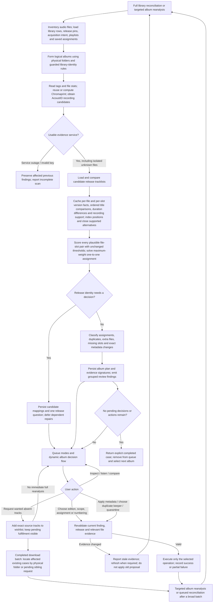
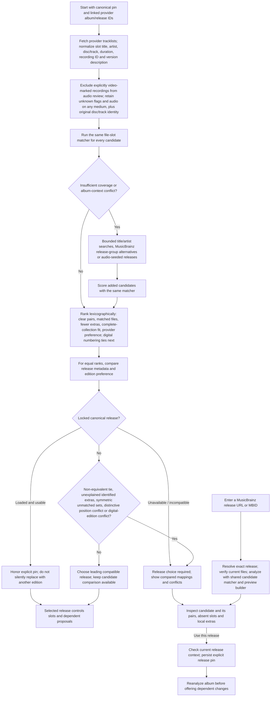
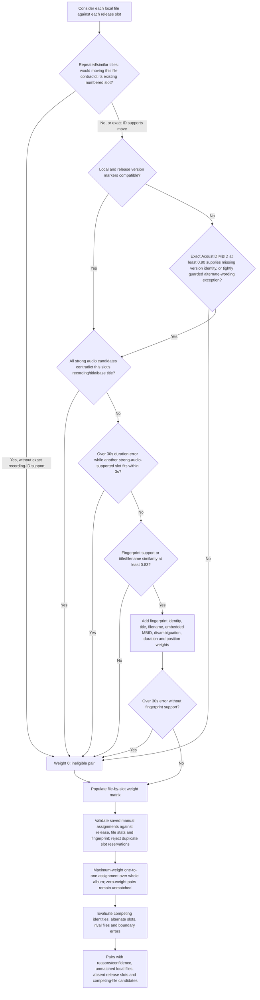
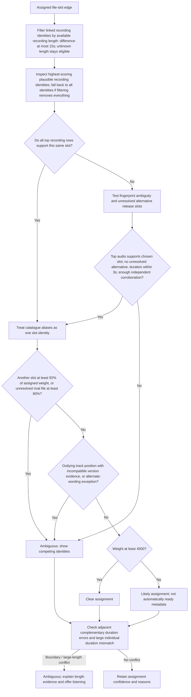
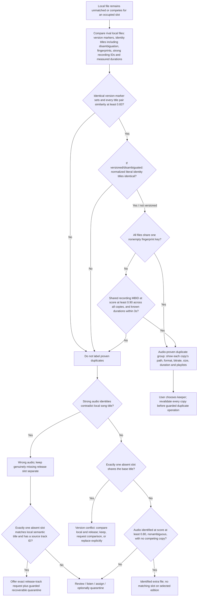
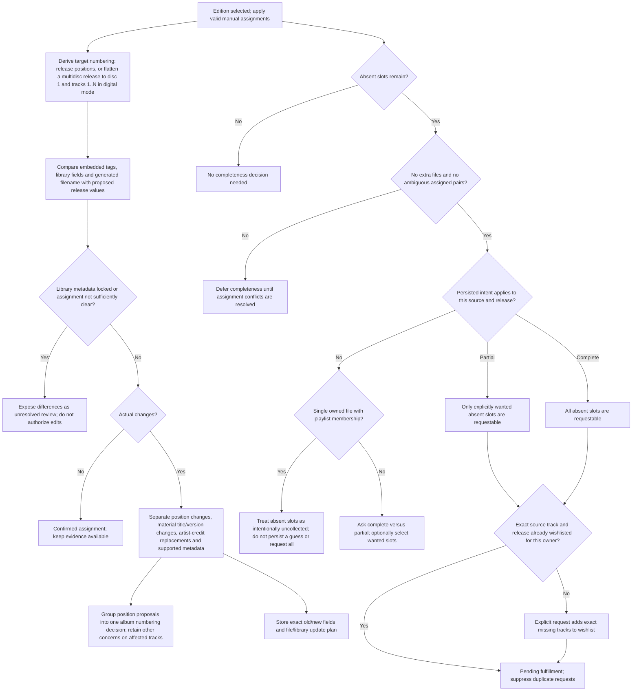
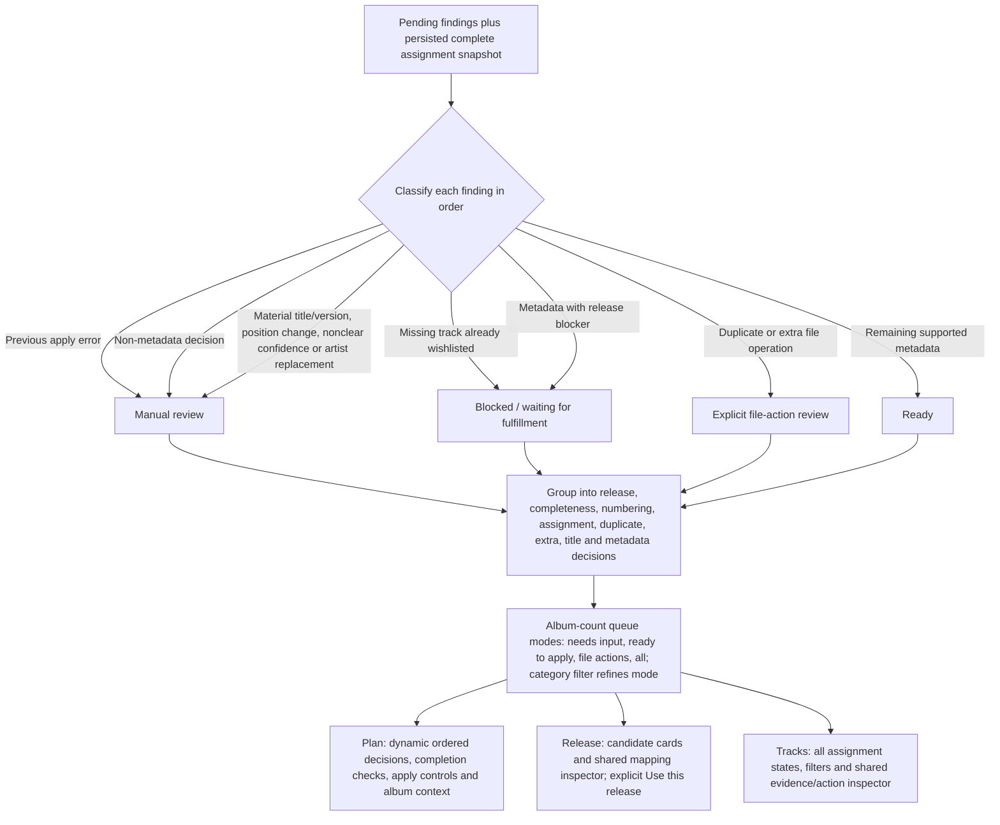
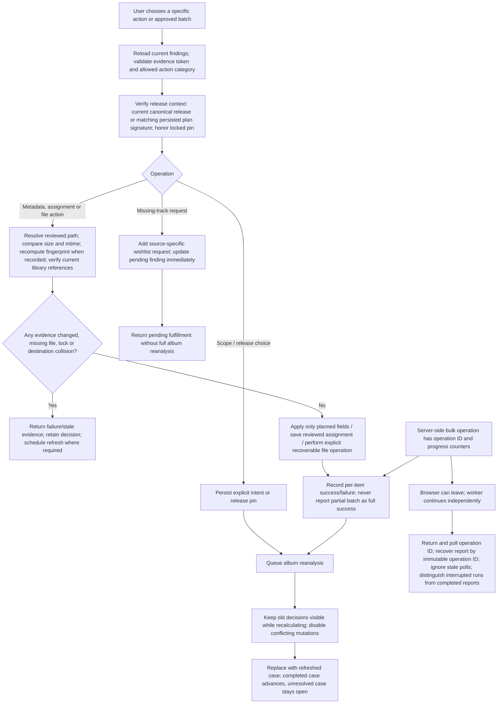
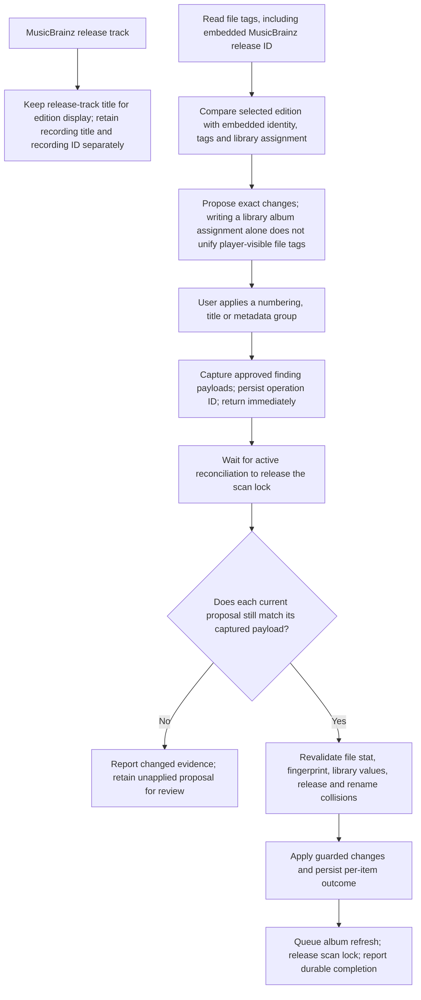

# Reconciliation architecture

The Review Queue owns an album decision workflow. Tools owns specialized maintenance jobs. A release slot identifies one position on one concrete edition; an assignment connects a local file to that slot. Confirming an assignment does not approve every proposed metadata edit.

Read this with [the regression catalogue](edge-cases.md) and [the testing guide](testing.md). Earlier implementation reports and benchmarks are preserved in [history](history.md); they are not current setup instructions.

## State ownership

The domain lives in `core/reconciliation/`. Separate stores have separate lifetimes; replacing them with one mutable status would discard useful distinctions.

| Layer | Authority and owner | Lifetime / invalidation |
| --- | --- | --- |
| Observed evidence | `evidence.py`, `catalogue.py`, `match_cache.py`; file stats, tags, fingerprints, provider responses | Recomputed or reused only with matching inputs; never grants approval |
| Album policy | `album_state.py`, `decisions.py`, `audio_copy.py`; canonical release pin, scope, wanted slots, numbering, leave-as-is disposition | Explicit user decisions, scoped to review identity and relevant release/slot dependencies |
| Track policy | `choices.py`, `settled.py`, persisted manual assignments | Pending approvals and current accepted exceptions; matching guards still apply |
| Acquisition | `fulfillment.py`, `replacement.py`, `requests.py` | Exact request receipts and replacement/playlist handoff journal; wishlist absence is not proof of fulfillment |
| Operations | Worker operation reports, `application.py`, `execution.py`, `organization.py` | Execution history and restart recovery; reports are not decision authority |
| Projection | `projection.py`, `store.py`, `queue.py`, `policy.py`, `search.py` | Replaceable album plan/findings/read models derived from the authorities above |

`stores.py` is the migration inventory for album-keyed and JSON-backed stores. Adding a new current-policy store also requires migration, collision, history-retention, and lifecycle tests.

### Stable identity and migration

`reconcile_reviews` assigns a stable UUID and decision revision. Case aliases keep existing folder/album links usable when a media server replaces an album ID. `migration.py` moves every registered store inside the album migration transaction, uses a savepoint, merges only compatible state, and rolls the whole migration back on a policy collision. A replacement keeps its operation ID and playlist journal through identity migration. Physical relocation is accepted only when the indexed track and unchanged file evidence prove one new path.

Startup upgrades are versioned in `reconcile_schema_versions`: identity/numbering adoption (1), semantic approval signatures (2), current accepted policy (3), and legacy acquisition repair (4). Each version commits with its data changes, runs once, and fails startup visibly if it cannot complete. `ensure_schema` helpers perform DDL, not business-state repair. Query helpers do not migrate data.

### Decision dependencies and approval

Numbering is one album decision keyed to selected source/release and the ordered release slots. A later track assignment does not erase that decision. A different edition or changed slot structure invalidates it. Keeping current numbering remains independent of accepting other metadata. `fields.py` owns position fields and aliases, including disc totals, across planning and preview.

`signatures.py` versions meaningful approval dependencies. Titles used only for display, transient explanatory annotations, and equivalent option ordering do not revoke approval. Changed files, release/slot identities, planned values, locks, competing copies, and unknown guard fields do. The original reviewed payload remains available for execution guards.

`settled.py` stores accepted field values and numbering evidence independently of prunable findings and reports. Later metadata decisions merge accepted fields rather than deleting unrelated numbering policy. Reopening removes the current exception. History pruning cannot resurrect the same accepted proposal.

### Commands, publication, and recovery

`commands.py` owns saved user decisions; `application.py` owns approved execution entry points; `execution.py` owns guarded file/tag mutations. These services compose with the generic repair worker, which still owns scheduling, reports, and non-review jobs.

A policy command commits its related rows and durable follow-up request together. `work.py` coalesces follow-up work by case and kind with a generation number. An old worker cannot acknowledge newer work. Failed work retains its error and retry time; startup resumes pending requests.

`publication.py` atomically publishes each album's findings and plan. Analysis captures decision revisions before doing expensive work; publication compares them inside the transaction. If a user changes policy during a scan, the old projection is discarded and a fresh replan is queued. Readers use a consistent SQLite snapshot. Network/catalogue work stays outside the short publication transaction.

Operations revalidate actual file state before mutation. Partial success remains partial success; restart does not replay a half-applied operation. A replacement waits for an exact verified arrival and playlist handoff before quarantining the old file. Ordinary removal still requires resolving or explicitly acknowledging its current playlist references.

## Code map

| Responsibility | Owner |
| --- | --- |
| Scan orchestration and deferred work | `core/repair_jobs/library_reconciliation.py` |
| Logical inventory, discovery scope, album identity | `grouping.py`, `inventory.py`, `identity.py` |
| Candidate discovery/ranking and manual release preview | `discovery.py`, `selection.py`, `candidates.py` |
| Matching, version checks and metadata proposals | `plan.py`, `metadata.py`, `display.py`, `file_evidence.py` |
| Atomic publication, saved plan, queue/readiness/search | `publication.py`, `projection.py`, `store.py`, `queue.py`, `policy.py`, `search.py` |
| Query overlay / saved decisions / follow-up | `queries.py`, `commands.py`, `refresh.py`, `work.py` |
| Apply, acquisition and file handoff | `application.py`, `execution.py`, `requests.py`, `fulfillment.py`, `replacement.py`, `organization.py` |
| Identity and policy persistence | `decisions.py`, `choices.py`, `settled.py`, `album_state.py`, `migration.py`, `stores.py`, `redirects.py` |

Module names without a prefix are under `core/reconciliation/`.

### Frontend boundaries

`webui/src/routes/review/-ui/review-page.tsx` assembles the workspace. `queue-sidebar`, `album-header`, `album-decisions`, `album-release`, `album-tracks`, and `album-context` own their sections. `use-review-controller` coordinates selected album, dialogs, and user actions; it does not recreate backend readiness rules. `use-review-queue`, `use-reconciliation-status`, and `use-review-operation` own their independent request lifetimes. `use-request-scope` aborts superseded requests and rejects late results, including failure recovery and release pinning.

`review-album-model` derives display groups from server facts; `review-presentation` and `review-labels` share wording. Component styles are grouped under `styles/` and imported through one CSS module, preserving the shared class namespace. Buttons, metadata comparisons, badges, dialogs, playback, and release metadata reuse application components.

## Provider-backed MusicBrainz discovery

A completely fitting provider edition may supply a better artist for a bounded MusicBrainz title/artist lookup when the local album artist is generic. Correcting a non-generic artist also requires majority audio-artist support. The fallback requires full clear coverage, compatible album title, one supported artist, high search score, exact normalized title, and a four-result limit. Candidates still pass the ordinary matcher and ranking. An explicit provider pin remains selected. This addresses LIVE's *Awake The Best Of Live* without treating accents as permission to relax identity checks.

## 1. End-to-end lifecycle

A successful full scan retires obsolete findings and, when plan persistence completed, unseen plans. A stopped scan or unavailable root must not make old work disappear. A targeted scan retires only findings/plans in the logical album's member folders. Merely leaving a queue filter, failing a request, or receiving an empty page does **not** establish completion.

## 2. Inventory and evidence acquisition

```mermaid
flowchart TD
    Roots{"AcoustID client available and all library roots accessible?"}
    Roots -->|No| Stop["Stop early; retain existing review state"]
    Roots -->|Yes| Scope{"Requested inventory scope"}
    Scope -->|"Routine review refresh"| Saved{"Saved roots, database membership and surrounding directory observations agree?"}
    Saved -->|Yes| Known["Reuse ordered logical-album paths; load only its album database rows; retain trusted group anchor"]
    Known --> Stat
    Saved -->|"Changed membership / new sibling files"| Discover["Discover sibling folders and related album rows, including same-title fragments"]
    Scope -->|"Manual reanalysis / edition choice / download arrival"| Discover
    Discover --> Bounded{"One verifiable discovery root preserves grouping order?"}
    Bounded -->|Yes| LocalWalk["Walk selected discovery root; run the same logical-album grouping rules"]
    LocalWalk --> Join
    Bounded -->|No| Walk
    Saved -->|"Old plan / changed configured roots / unusable scope evidence"| Walk
    Scope -->|"Full library scan"| Walk["Walk all configured roots; exclude watchlist-removal recovery directories"]
    Walk --> Join["Join stored library paths to actual files; accept path aliases only with physical-file identity"]
    Join --> Logical["Group folders into logical album inventory"]
    Logical --> Stat["Read path, size and nanosecond modification time"]
    Stat --> Tags["Use stat-keyed tag cache or read embedded title, artist, album, numbers, IDs and duration"]
    Tags --> Fingerprint{"Unchanged file with cached usable fingerprint?"}
    Fingerprint -->|Yes| LookupCache
    Fingerprint -->|No| Calculate["Calculate Chromaprint; reject empty payload or nonpositive/nonfinite duration"]
    Calculate --> LookupCache{"Fingerprint-keyed AcoustID result cached?"}
    LookupCache -->|Yes| Recordings["Use recording MBIDs, titles, artists, scores and available recording lengths"]
    LookupCache -->|No| Lookup["Query AcoustID with bounded retries; cache only successful or genuine no-match results"]
    Lookup --> Recordings
    Lookup -->|"Repeated service failure"| Circuit["Circuit breaker defers further lookups; preserve affected album findings"]
    Calculate -->|"Isolated decoder / fingerprint error"| Unknown["Keep sibling analysis; mark this file's identity uncertain"]
    Recordings --> Layers["Combine audio evidence with filename, embedded tags, library metadata, recording disambiguation and playlist membership"]
    Unknown --> Layers
```

### Logical album grouping is deliberately constrained

- Conventional `Disc N` / `CD N` folders may form one album. Folders already belonging to the same library album are grouped together.
- Different library IDs in parent/disc-child folders require compatible normalized album identity and no conflicting authoritative release identity. Without a release anchor, their positions must be disjoint.
- Soundtrack fragments use guarded album-title/owner/position and release-anchor rules; track performer alone does not determine album ownership.
- Regular-plus-deluxe addenda use a narrow rule: 2–12 deluxe files with a release identifier, a sibling regular album of at least 8 files, matching base title, artist and owner, and nonoverlapping continuous positions. The regular album must occupy `1..N`; deluxe extras must start at `N+1`, use disc 1, and stay within `3N`. Exactly one regular candidate must fit. This combines the review inventory; it does not move or retag files.
- Other uncertain mixed-album folders remain reviewable rather than being silently merged.

The evidence cache uses retry delays of 1, 2, 4 and 8 seconds and a service-failure circuit threshold of 3. Renaming/tag editing can invalidate the path/stat cache while still reusing the fingerprint-keyed lookup. Cache failure is not evidence that a song is absent.

- Unindexed sibling download folders join exactly one release-backed album only when every file agrees on the exact album and artist tags, preserving edition qualifiers. Multiple owners, mixed tags, or unknown tags keep folders separate. Joint recording/version/duration assignment follows grouping; grouping alone never verifies audio or moves files.

## 3. Release discovery, ranking and edition choice

Important limits and distinctions:

- Audio-seeded discovery uses up to 3 distinct, nonambiguous recording MBIDs with top scores at least 0.80, votes for up to 5 releases, and bounds the initial candidate list to 6. Later guarded searches/expansions can add candidates. This is bounded discovery, not an exhaustive catalogue search.
- An exact MusicBrainz release ID is distinguished from a release-group identifier. Missing-track requests target the concrete edition returned by the adapter.
- Candidate rank is a tuple, not a single confidence percentage. Provider preference breaks ties after audio fit and coverage; it cannot outrank more clear/matched files or fewer extras.
- Equivalent candidate shapes can avoid an unnecessary edition question. A stored **unlocked** release is a hint; it cannot suppress a meaningful tracklist/position conflict.
- A single recording may appear on many compilations. For a one-file album, a conflicting album title triggers a contextual search. Only equally fitting context candidates are promoted; otherwise album identity remains unresolved.
- Inspecting a card or manually loading a release does not pin it. Pinning and reanalysis are separate operations.

## 4. File-to-slot eligibility and weighted assignment

### Pair score contributions

These are ranking weights, **not probabilities**. Only the strongest applicable fingerprint contribution is used; other supported layers add to it.

| Evidence | Eligibility / contribution |
| --- | --- |
| Exact AcoustID recording MBID | Score at least 0.80; `floor(10000 × score)` |
| AcoustID title/artist/version support or allowed base-title support | Score at least 0.80; `floor(5000 × score)` |
| Embedded title | Similarity at least 0.83; `floor(1200 × similarity)` |
| Filename title, after extension/leading-position removal | Similarity at least 0.83; `floor(1500 × similarity)` |
| Embedded MBID equals slot recording ID | +300 with fingerprint support, otherwise +1200 |
| Nonempty normalized library recording disambiguation equals release disambiguation | +300 |
| Duration difference 0–3000 ms | `800 − round(delta × 600 / 3000)` |
| Duration difference 3000–15000 ms | `100 − round((delta − 3000) × 75 / 12000)` |
| Duration difference above 15000 ms | No duration bonus; above 30000 ms without fingerprint support is rejected |
| Title agrees and track number agrees | +100; this is corroboration, not the principal identity test |
| Valid saved manual assignment | Chosen edge receives 1,000,000 and other edges for that file receive 0; confidence is explicitly `manual` |

Title similarity normalizes text, uses `SequenceMatcher`, rejects ratios below 0.78, checks plausible shared identity, rejects conflicting numeric tokens, and requires matching version-marker sets. The later title-support thresholds are normally 0.83; recording-title support uses 0.88. Artist-credit support accepts compatible component credits or sufficient normalized similarity (0.75).

Version evidence comes from embedded title, filename, library title and recording disambiguation. `alt`, `alternate` and `alternative` normalize together; acoustic session wording is folded conservatively. Named live performances, remixes, instrumental/acoustic versions and other material qualifiers are not globally stripped.

**Cheap Trick exception:** a local alternate/extended label and release alternate/extra-bridge label may pair only with the exact recording MBID at AcoustID score ≥0.90, duration difference ≤1000 ms, compatible artist evidence, a shared `alternate` marker, and marker-set difference exactly `{extended}`. The pair still requires version review.

## 5. Confidence and competing evidence

Context can resolve a many-to-many fingerprint when title/filename/embedded-ID support count is at least 2, **or** artist plus top exact recording ID agree, **or** artist plus disc/track position plus one metadata layer agree. It also requires chosen duration within 3 seconds and no unresolved alternative slot. A rival already securely assigned elsewhere is not automatically a duplicate: its own metadata support, audio support, duration and weight must be evaluated.

Boundary checks include adjacent slots on the same disc with opposite duration errors whose sum differs by no more than 3 seconds, with the initiating error at least 20 seconds. A similar check considers a neighboring missing slot plus an extra file with matching title. Independently, an assigned duration error at least `max(20 seconds, 6% of release duration)` becomes ambiguous. Manual assignments bypass these automatic confidence downgrades; their status remains explicitly reviewed.

## 6. Duplicate copies versus versions, wrong audio and extras

The shared-fingerprint duplicate path does not require an additional duration comparison because the fingerprint key already includes duration. On the shared-MBID path, missing duration values are ignored; fewer than two known durations cannot disprove compatibility. Similar names alone, or a shared low-confidence catalogue ID, do not prove duplicates.

## 7. Numbering, metadata and acquisition intent

The scanner proposes filenames but does not automatically reorganize the album folder. “Apply metadata” covers supported file tags, library fields and planned filename changes. Folder organization is a separate option, available only when the album plan has no manual, destructive or blocked work. Single-disc position errors can still need renumbering; they are not described as a multidisc flattening choice.

Display-title policy can preserve a unanimous useful local album title rather than importing redundant provider suffixes. Recording disambiguation can preserve performance detail even when the release's track title is short. Material song/version changes and replacement of existing artist credits remain review decisions.

## 8. Queue risk classification and UI projection

The UI distinguishes **confirmed by evidence**, **previously reviewed**, **numbering preview**, **ready metadata**, **unresolved**, and **waiting for fulfillment**. A purple selected-row outline means selection only; it does not change risk or confidence. A green completed decision is distinct from a ready action that has not yet been applied. Counts refer to albums, tracks/slots, actions or grouped field changes as labeled; these quantities are not interchangeable.

Queue mode totals use a count-only summary request and shared SQL predicates; they do not hydrate album pages or artwork. Finding readiness, whole-album buckets and the historical ready-action total remain distinct projections. Refresh overlays count an existing case once even when it is on another page.

Right-hand panels share the workspace column definition. On narrow screens the queue becomes a vertically scrollable list above the album; track detail uses the responsive inspector. The presentation helpers and extracted row/detail components share labels and data coercion instead of defining them independently in each view.

## 9. Applying decisions and refreshing safely

Additional application constraints:

- Duplicate keeper choice verifies every reviewed copy's current library path and physical identity, file stats and fingerprint before invoking the guarded duplicate operation. Changed IDs/paths trigger refreshed evidence rather than bypassing the guard.
- Saved assignment overrides are scoped to release and file evidence. Two files cannot manually reserve one release slot. Saving an assignment changes the proposed plan and reanalyzes the album before dependent metadata is offered; it does not write file tags. Pending metadata inspectors retain assignment controls and allow resetting the saved override.
- Metadata apply checks current tag/library values, metadata locks and rename collisions. It is not blanket permission to overwrite unrelated fields or choose a different release.
- Recoverable quarantine is explicit; the ordinary ready-metadata batch excludes it.
- Operation reports are persisted at start, after each item and at completion, retained for 30 days. A restarted worker marks unfinished reports as interrupted; it does not replay them. Organization and reanalysis are reported as queued, separately from completed metadata edits.
- Bulk jobs report individual failures. Navigation does not cancel an in-process server job; a server restart is different, and an unavailable operation report is surfaced rather than invented as success.
- Broad batches can queue a full reconciliation. Completion of a scan that began before the action cannot stand in for the post-action refresh.
- Successfully wishlisting a missing track keeps the album pending until fulfillment is reconciled. A wishlist state is not proof of download completion.

Thresholds above describe current code, not a user-facing guarantee of identity. The important review boundary is that a strong score may produce a candidate assignment while a version, competing-file, duration, lock or release conflict still requires a human decision.

## Review refinements (2026-10-17)

Release comparison renders missing audio slots at their actual disc/track positions. Unassigned files remain separate. Equal display titles alone do not establish that an extra file is an alternate version of a missing track. The `(Exchange)` case illustrates why duration and fingerprint evidence must remain available.

Embedded release-ID repair is proposed for mixed identities within a logical album (including a mixture of present and absent IDs), or for an explicitly pinned MusicBrainz edition. A coherent existing identity is preserved when automatic matching merely prefers an equivalent pressing. The write target is the concrete release ID, never a release-group ID.

MusicBrainz candidates with identical recording IDs at every assigned and missing disc/track position are equivalent even when their release titles use different translations. Session titles can inherit the recording comment’s additional “live” marker only when the complete session title, artist, exact high-confidence recording ID and duration within one second agree, with no conflicting stored recording comment.
